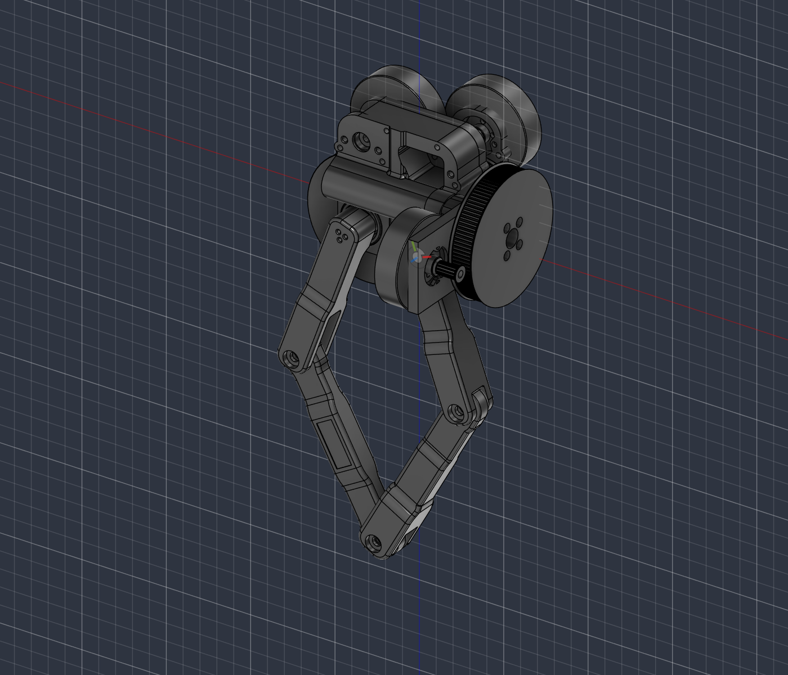

# Robot Dog · Project Guide

A compact quadruped project exploring how affordable, custom-built actuators can support dynamic legged motion. The long-term goals are sprinting, jumping and eventually a backflip. Development currently centres on the actuator platform and its transition into a working leg.

*Development CAD, November 2026. This layout is still being refined; it is not a completed or mechanically validated assembly.*

## The project at a glance

| | |
|---|---|
| Intended robot | Approximately 4 kg, with 12 independently controlled joint motions |
| Actuator approach | Brushless motors with compact 9:1 timing-belt reductions |
| Leg mechanism | A five-bar linkage, with two motors coordinating the foot in a plane |
| Control approach | Adjustable joint stiffness and damping, commanded over CAN |
| Current stage | Actuator bench development and first-leg integration |

The central idea is to control how a joint responds to a load, as well as where it moves. A joint can be commanded to behave like a spring and damper: resisting displacement, absorbing motion, or applying a deliberate torque. This provides a foundation for studying contact with the ground and, later, dynamic movement.

## Explore the project

| Read | What it explains |
|---|---|
| [Design](design.md) | The actuator, leg mechanism and main design trade-offs |
| [Progress](progress.md) | What has been demonstrated and what comes next |
| [Technical reference](technical.md) | The control architecture, joint interface and source-code map |

The documentation presents the project at a system level. Per-unit calibration records, operating procedures and session logs remain part of the internal engineering workflow.

**Status reviewed: 15 November 2026.** The [progress page](progress.md#code-and-validation-status) distinguishes published implementation from physical validation.
