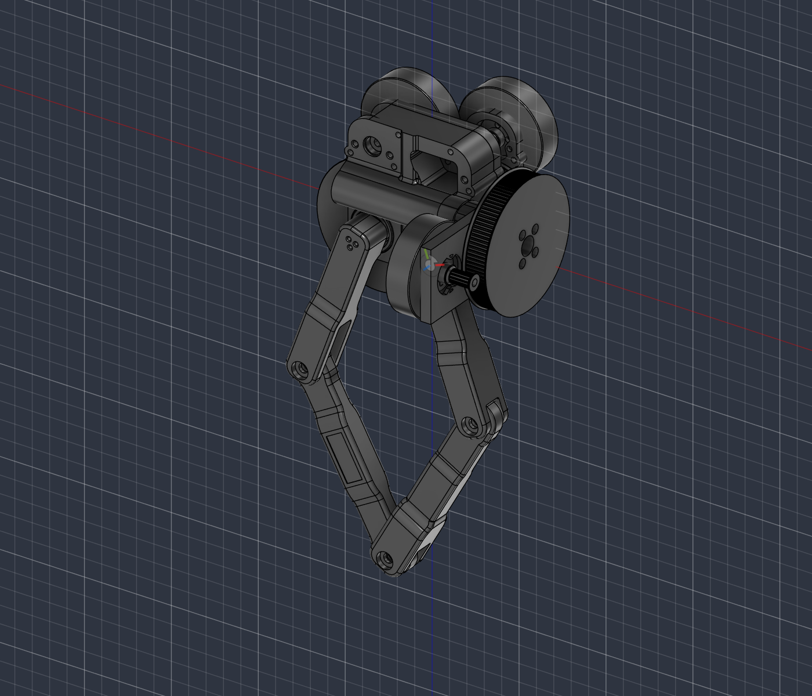

# Robot Dog

A compact quadruped in development, starting with custom belt-driven actuators and compliant joint control. The long-term goals are sprinting, jumping and eventually a backflip.

**Current stage:** actuator bench development and first-leg integration. Walking and dynamic manoeuvres have not yet been demonstrated.

  

*Development CAD, November 2026. Mounting and clearance details are still being refined; this is not a completed or mechanically validated assembly.*

## The approach

The intended robot is approximately 4 kg with 12 independently controlled joint motions. Brushless motors drive the joints through compact timing-belt reductions. A five-bar leg mechanism keeps its two foot-positioning motors near the hip.

Each joint can be commanded to behave like a spring and damper, with adjustable stiffness, damping and an additional torque input. The aim is to develop useful control of contact with the ground, building from measured actuator behaviour toward a complete robot.

The work combines custom mechanical design, firmware development and system integration with commercial motors, driver boards and the SimpleFOC library.

## Explore

| Read | What you will find |
|---|---|
| [Project guide](docs/readme.md) | A short introduction and project summary |
| [Design](docs/design.md) | Mechanism and principal engineering choices |
| [Progress](docs/progress.md) | Demonstrated work and the next milestones |
| [Technical reference](docs/technical.md) | Control architecture, joint interface and source-code guide |

Motor control, belt transmission and selected joint-control behaviours have been tested on individual bench configurations. First-leg positioning and loaded operation remain separate development milestones. The [progress page](docs/progress.md) records that scope.
